# CHIMERA

**Raise a creature on your Solana BP26 badge, splice its DNA with the people you meet, battle them, and line up
3 to 6 badges to fuse a colossus.**

By [MrNameless10](https://github.com/MrNameless10). A Lua 5.5 app for the Breakpoint 2026 badge, 22 files, 65 KB,
built to run inside the badge's 48 KB of Lua heap.

<p align="center">
  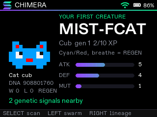
  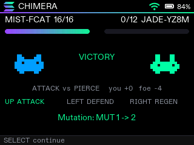
</p>

<p align="center">
  <a href="#try-it">Try it</a> ·
  <a href="#how-to-play">How to play</a> ·
  <a href="#screens">Screens</a> ·
  <a href="https://mrnameless10.github.io/chimera-badge/">Bestiary</a> ·
  <a href="#how-it-works">How it works</a> ·
  <a href="#simulator-and-tests">Simulator and tests</a>
</p>

## What it is

Every badge hatches a creature from a 9-gene genome. The genes pick its colours, head, body, light pattern, battle
stats and a name that no other look shares. It grows from **Cub** to **Young** to **Adult** as you play, and it
only changes when you meet other people:

- **Splice** with another badge to breed a new generation that mixes both genomes, sometimes with a mutation.
- **Battle** another badge: three rounds of rock-paper-scissors with abilities, cheat-proof by commit-reveal.
- **Swarm**: stand 3 to 6 badges in a row and keep a heartbeat running down the line to grow a colossus. Everyone
  inherits one of its genes.
- The **LEDs speak**: your creature's light pattern is its temperament and its battle ability, so you can read a
  rival's power from across the room. LEDs 7 and 8 are a radar for the nearest CHIMERA.

Everything runs over the badge mesh. No servers, no accounts, no wallet.

## Try it

### In the browser, now

The official badge emulator runs the real firmware. This repo ships a small installer that loads CHIMERA into it:

1. Open the [BP26 emulator](https://solana.com/breakpoint/badge/emulator) on a desktop browser.
2. Open the developer console (<kbd>F12</kbd>, or <kbd>⌥</kbd><kbd>⌘</kbd><kbd>J</kbd> on a Mac) and paste:

   ```js
   await import("https://cdn.jsdelivr.net/gh/MrNameless10/chimera-badge@v1.0.0/emulator.js")
   ```

3. The creature hatches on the emulated badge. Use the on-screen buttons or the keyboard
   (arrows, <kbd>Enter</kbd> = SELECT, <kbd>Esc</kbd> = CANCEL).

To play with other badges, open more emulators in new tabs (`/breakpoint/badge/emulator?badge=2`, `?badge=3`, …),
run the installer in each, and join each badge to the demo Wi-Fi once by typing `wifi connect "Solana Demo" x` in
the emulator's own console box. Tabs in one browser share a radio, so they find each other in the scan. Browsers
slow down timers in background tabs, so the swarm's 600 ms timing is best played on real badges.

### On a badge

- **App Store**: CHIMERA 1.0.0 is
  [submitted to the BP26 App Store](https://solana.com/breakpoint/badge/apps/app?id=chimera) under Games and is
  waiting for review. Once it passes, install it from the store app on the badge.
- **Before that**: download `chimera-1.0.0.zip` from [Releases](https://github.com/MrNameless10/chimera-badge/releases),
  drop it on the [submit page](https://solana.com/breakpoint/badge/apps/submit) and use **Run on badge**
  (Chrome or Edge on a computer, a badge with a microSD card and Solana OS 0.5.0 or later). It compiles the code
  on the badge, the tightest memory mode, which CHIMERA is tested for.

### The Bestiary

[mrnameless10.github.io/chimera-badge](https://mrnameless10.github.io/chimera-badge/) shows every creature the game
can hatch, drawn from the same sprite atlas the badge reads: 64 head × body combinations in three stages, their
LED patterns, abilities and names. Type any name you see on a badge (for example `MIST-FCAT`) to find its page.

## How to play

| Where | Key | What happens |
| --- | --- | --- |
| Home | SELECT | Scan for badges running CHIMERA nearby |
| Home | LEFT | Swarm lobby |
| Home | RIGHT | Lineage: your splices and mutations |
| Scan | UP / DOWN, SELECT | Pick a badge and ask to splice |
| Scan | RIGHT | Challenge the selected badge to a battle |
| Challenge | SELECT / CANCEL | Accept or decline |
| Battle | UP / LEFT / RIGHT, SELECT | Attack, defend or ability, then lock it in |

### Growing

| Stage | XP | Looks like |
| --- | --- | --- |
| Cub | 0–9 | Head and feet |
| Young | 10–29 | Body without accents |
| Adult | 30+ | Full body |

XP: meeting a new badge +1 (each badge counts once), battle +2 (win +3), splice +3, an evolved colossus +5.
A splice keeps your stage: new DNA changes the look, never the growth.

### Splice

Each gene comes from one of the two parents at random; the MUTATION genes of both set the odds of a mutation
(at most 1 in 8 per gene). The result screen colours each gene by where it came from: white yours, aqua theirs,
pink mutated. The same pair can splice again after 30 minutes.

### Battle

Three rounds, 10 seconds per pick. **Attack** beats **ability**, **ability** beats **defend**, **defend** beats
**attack**. Each creature's ability comes from its light pattern:

| Light | Ability | Effect |
| --- | --- | --- |
| breathe | REGEN | heals 3 + MUT/2 and deals MUT/4 |
| chase | PIERCE | deals (ATK + MUT)/2 + 0 to 3 |
| sparkle | SURGE | deals MUT/2 + 1 + 0 to MUT+1 |
| flicker | DRAIN | deals 1 + MUT/2 and heals half + 1 |

HP is 8 + 2 × DEF. Both badges send a hash of their move first and reveal it after, so nobody can change their
pick after seeing the other's; both compute the same result from the same seed without sending HP. A win raises
ATK, DEF or MUT by one point, once per rival among your last 8.

### Swarm and colossus

Press LEFT on home on 3 to 6 badges. The lobby gives everyone a role (HEART, WINGS, BRAIN, …) and a place in the
line. The HEART starts the pulse with SELECT; it travels down the line 600 ms per badge and each player presses
SELECT when their screen says **NOW!** (±200 ms). Enough hits in a row and the colossus evolves:

| Badges | Hits needed per pulse | Chain to evolve |
| --- | --- | --- |
| 3 | 3 | 4 |
| 4 | 4 | 3 |
| 5 | 4 | 6 |
| 6 | 5 | 5 |

The colossus's genome is the most common value of each gene among the members. When it evolves, each member takes
one gene from it where theirs differs, and the lineage remembers it.

### The light language

- The LED pattern is the creature's temperament and ability: breathe, chase, sparkle or flicker.
- For 10 minutes after a win, a splice or an evolution it runs twice as fast.
- After an hour without meeting anyone the glow fades to about a third.
- LEDs 7 and 8 show the colour of the strongest CHIMERA nearby and blink faster as it gets closer.

## Screens

Captured from the official emulator running this code.

<table>
  <tr>
    <td align="center"><br><sub>Your creature, its genes and XP</sub></td>
    <td align="center">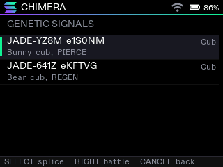<br><sub>Scan: badges nearby</sub></td>
    <td align="center">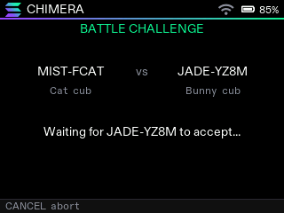<br><sub>Challenge sent</sub></td>
  </tr>
  <tr>
    <td align="center">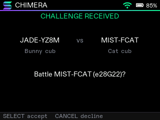<br><sub>Challenge received</sub></td>
    <td align="center">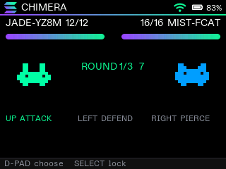<br><sub>Round 1, 7 s to pick</sub></td>
    <td align="center">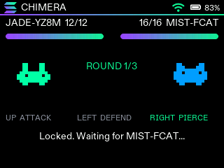<br><sub>Move locked, waiting for the reveal</sub></td>
  </tr>
  <tr>
    <td align="center"><br><sub>Victory and a mutation</sub></td>
    <td align="center">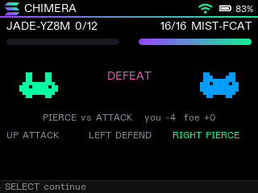<br><sub>The same battle on the other badge</sub></td>
    <td align="center">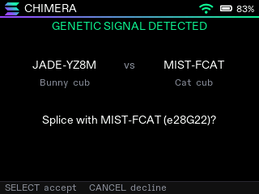<br><sub>Splice request</sub></td>
  </tr>
  <tr>
    <td align="center">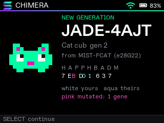<br><sub>New generation, genes coloured by origin</sub></td>
    <td align="center">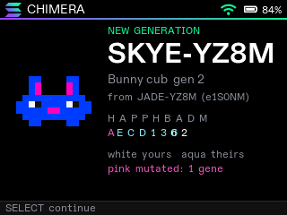<br><sub>The partner's child from the same splice</sub></td>
    <td align="center">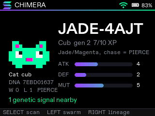<br><sub>Generation 2 at home</sub></td>
  </tr>
  <tr>
    <td align="center">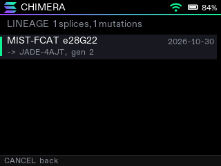<br><sub>Lineage</sub></td>
    <td align="center">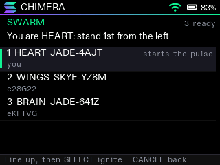<br><sub>Swarm lobby: three badges, three roles</sub></td>
    <td align="center">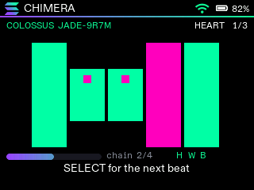<br><sub>Colossus: each badge shows its segment</sub></td>
  </tr>
</table>

## How it works

The badge gives each app 48 KB of Lua heap, and the saved data lives in that heap too. CHIMERA is built like an
operating system with overlays:

- **A small resident kernel** (`main.lua`) holds the creature, the peer list, routing, XP and memory management.
- **Each screen is an overlay** loaded when it opens and dropped when it closes. Before every screen the kernel
  frees the old one and forces a full garbage collection, so each screen starts with all the free memory.
- **Heavy screens build in stages.** The battle lays out its view, drops the layout code, then compiles the logic;
  the colossus does the same, and only the HEART badge loads the heartbeat code.
- **Every collection has a fixed bound** (8 peers kept by signal strength, 8 rivals, 8 splice cooldowns, 16 lineage
  entries, a 512-bit set for badges met), so the worst case is known in advance.
- **Sprites are rectangles.** `tools/sprites.py` turns 8 heads × 8 bodies × 3 stages into a 25 KB atlas of 384
  records with direct indexing; the badge reads one sprite with two file reads.
- **Names are a bijection.** Genes 2–6 go through `x·0x9E3B5 + 0x5A5A5 mod 2²⁰` and are written in Crockford
  base 32, so two different looks never share a name and the Bestiary can invert any name.
- **Everything from outside is checked**: messages, stored data and names, so a corrupt save or a hostile badge
  cannot crash the app.

Measured margins: about 17 KB free on the busiest screen when installed from the store, and 3.8 KB in the worst case
when compiled on the badge (emulator, Run on badge) with a full lineage.

The full design, with the data-structure and memory tables, the protocol and the test suites, is in
[`chimera/README.md`](chimera/README.md).

## Repository

```
chimera/              the app, exactly as published
  main.lua            kernel
  screens/            one file per screen
  lib/                battle, genome, light, sprites, colossus logic
  data/sprites.bin    sprite atlas
  app.json            store manifest
emulator.js           installer for the browser emulator
docs/                 the Bestiary (GitHub Pages) and screenshots
tools/sprites.py      builds data/sprites.bin
tools/bestiary.py     builds docs/index.html from tools/bestiary.html and the atlas
tools/sim/            badge simulator and test suites
```

Rebuild the atlas and the Bestiary:

```bash
python3 tools/sprites.py chimera/data/sprites.bin
python3 tools/bestiary.py tools/bestiary.html chimera/data/sprites.bin docs/index.html
```

## Simulator and tests

`tools/sim` runs CHIMERA on any number of simulated badges in the terminal. It compiles Solana OS's own Lua 5.5 to
32-bit WebAssembly and copies the badge host: the 48 KB allocator, the garbage collector settings, the instruction
limit per callback, the UI limits, the mesh at 4 messages a second and 200 bytes, and store versus on-badge code
loading. Its memory figures match the emulator within 2 %.

```bash
brew install zig node
tools/sim/build.sh
tools/sim/badgesim tools/sim/scenarios.lua chimera store
tools/sim/badgesim tools/sim/chaos.lua chimera dev
tools/sim/badgesim tools/sim/profile.lua chimera store 30
```

`build.sh` clones [solana-os](https://github.com/spacemandev-git/solana-os) for the Lua sources the first time.

- `scenarios.lua`: 26 scenarios with 1 to 6 badges: first boot, meeting, splice (cooldown, decline, timeout),
  battle (30 % packet loss, auto-lock, lost link, mutual challenges), growth, swarms of 3 to 6, radar, lonely hours,
  20 games in a row, a full lineage.
- `chaos.lua`: 35 attempts to break it: thousands of malformed and forged messages per screen, 60 badges in range,
  corrupted save files, random key mashing for 15 simulated minutes on a lossy, duplicating, reordering mesh,
  walking away at every step, a 10-badge swarm whose HEART leaves, the clock jumping back a day.

Both suites pass 2 928 runs (24 seeds × 2 loading modes × 61 scenarios).

## License

[MIT](LICENSE) © MrNameless10
